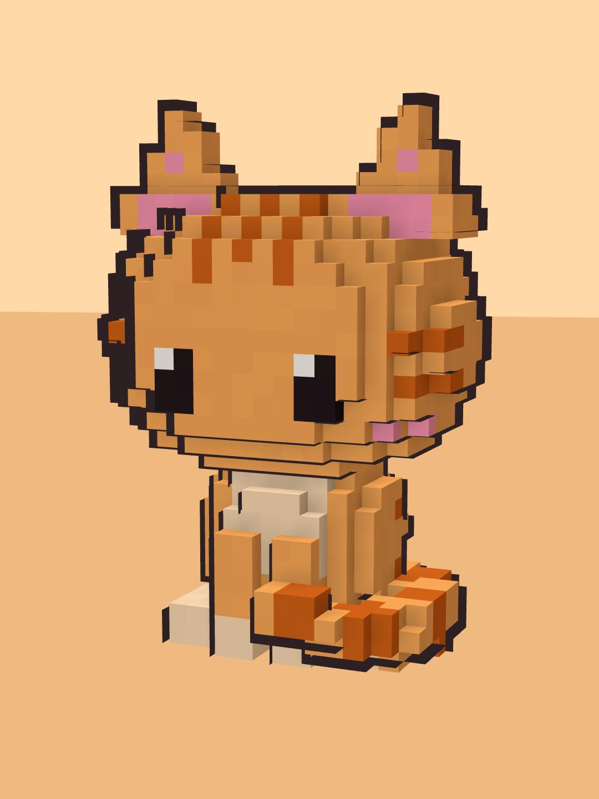
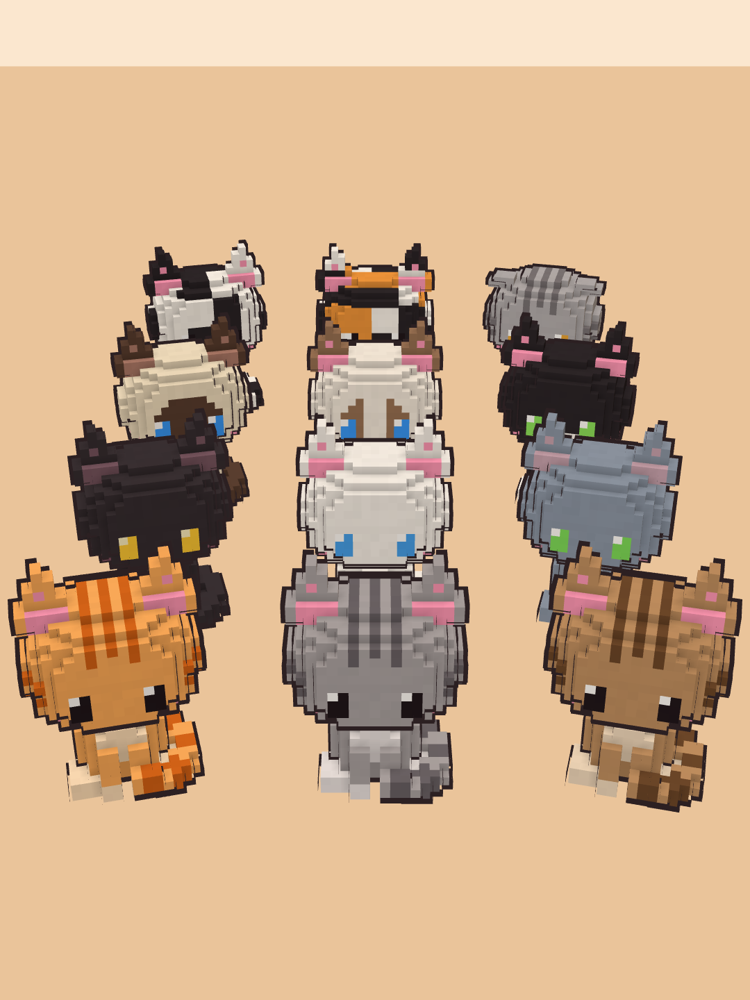
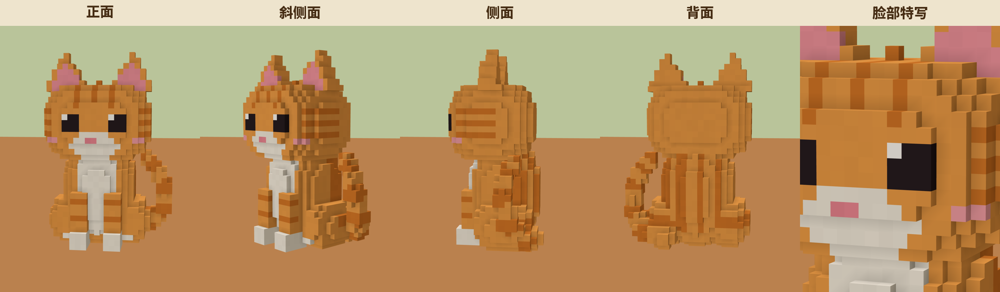

# 猫咪 3D 建模规范

「假如」系列的主角是一只**立体方块猫**（volumetric voxel cat）。这份文档记录最终选定的样子、走过的弯路，以及怎么用代码生成它。

代码在 [模型代码/](模型代码)，预览图在 [模型代码/预览/](模型代码/预览)。

## 最终版：普通密度、眼睛偏下、粗描边、无嘴无鼻

用户在比较三个版本后选定的是 **v2**（2026-11-21），并说「用这个来做视频」。这就是 `cat3d.js` 里的模型。



外形要点：

- **方块体素，而且是实心的**：头、身体、四肢、尾巴都是实心，从任何角度看都成立。不是纸片。
- 以猫在品牌橘猫为原型：大圆头、高耳朵、耳内粉色、额头 3 道竖纹、脸颊短纹、黑色豆豆眼、卷着绕到身前的条纹尾巴。
- **kawaii 比例**：大圆头（脸颊略宽）、平整的脸、大而尖的耳朵、梨形小身体、胸前奶油色、前爪并拢、后脚伸出。
- **眼睛**：2×3 体素的大黑眼，带一个白色高光，位置偏低（y 12–14）；脸颊有粉色腮红。
- **没有嘴，也没有鼻子。** 脸上只有眼睛和腮红。
- **粗黑描边**：用一个略微放大的背面壳（BackSide）做出品牌的深色轮廓线。
- 12 个品种：`orange / graytabby / brown / black / white / blue / siamese / ragdoll / tuxedo / cow / calico / fold`。



## 走过的弯路（不要再走）

| 版本 | 样子 | 结果 |
|---|---|---|
| 纸片精灵 | 平面像素图挤出一点厚度 | 用户嫌「纸片」，要真 3D |
| 圆润光滑卡通猫 | 圆润低多边形 | **「太丑了，你还是用方块的形状吧」**，已放弃，不要再提 |
| v1 | 方块 3D，大方块头，小眼睛 | **「一点都不像是猫，而且不可爱」** |
| **v2** | 加了 kawaii 比例、大低眼、腮红、梨形身体 | **最终版** |
| v3 | 体素密度翻倍（方块边长减半），描边变细，眼睛上移 | 用户看了说「还是要 v2」。保留为 `cat3d_v3_dense`，**不要用** |

用户当时的反馈原话：「我觉得眼睛可以上去一些？然后看那个方块的密度能不能再大一些，这样就没有这么像素」。试完之后他们还是更喜欢更方、更像素的 v2。结论：**这个品牌就是要方块感，别磨平它。**

## 其它规则

- 修改猫的细节时，只动轮廓线或密度，**不要**加高光、胡须、嘴、耳内粉色以外的东西，也不要改脸。加了细节的版本被否决过（「太丑」）。
- 猫群里远处的猫用低密度（`lod: true`，隔一个体素采样），近处和主角用正常密度，这样渲染不会太慢。
- 小恐龙也是同款方块造型（`dino3d`），没有嘴，脸要在每个镜头里完整露出。
- 恐龙演「你」，橘猫演「你家的猫」，灰猫演邻居，三花猫演新闻主播。

## 每秒翻倍系列用的变体：`bloopcat.js`

做「每秒缩小一半」时用户要求**强参考** Bloop 的橘猫，所以另做了一只更细密的橘猫：

- 细体素（比 `cat3d` 密很多），柔和的明暗，**没有黑色描边**。
- 大黑眼 + 白色高光，**小粉鼻子 + 白色嘴套**，粉腮红，额头 3 道短纹，白胸、白爪，前腿有环纹，尾巴有环纹。
- 依旧**没有嘴线**。（这条和 cat3d 的「无鼻」不同，因为参考片里有鼻子。）
- 姿势：`sit | loaf | walk | curl`，以及睁眼/闭眼。

注意：每个姿势的头部偏移量必须是**整数**，小数会让鼻子、腮红、闭眼线错位。体素循环的 z 范围要覆盖头部偏移后的位置（-17 到 22）。



## 怎么用

依赖 Three.js（试过 0.170.0）。

```js
import * as THREE from 'three';
import { cat3d, dino3d, BREED_NAMES } from './cat3d.js';

const cat = cat3d('orange', 0.1);              // 品种，缩放；opt: { closed: true 闭眼, lod: true 低密度, outline: false 去描边 }
cat.rotation.y = -0.28;
scene.add(cat);

const you = dino3d(0.13);                      // 小恐龙
```

光照：半球光（暖白 + 灰褐）强度约 1.5，加一盏从左上前方来的方向光 1.7，补一盏弱的补光。背景用暖色，地面用一块略深的暖色平面。

预览：

```bash
cd 模型代码
npm i three playwright                  # 也可以放进一个单独的目录
node shot.mjs hero breeds turn          # 输出 test_hero.png / test_breeds.png / test_turn.png
```

`shot.mjs` 会起一个本地静态服务，用 Chromium（SwiftShader，无 GPU 也能跑）截图。可用场景名：`hero`、`compare`、`turn`、`breeds`、`street`。

## 渲染注意

- 无头 Chromium 里 WebGL 要加 `--use-angle=swiftshader --enable-unsafe-swiftshader --ignore-gpu-blocklist`。
- 逐帧截图很慢（约 3 fps），整片按 6 个分片并行渲染。机器忙的时候更慢。
- 不要用 HEVC 当最终输出，用 H.264 + AAC，兼容性最好。
